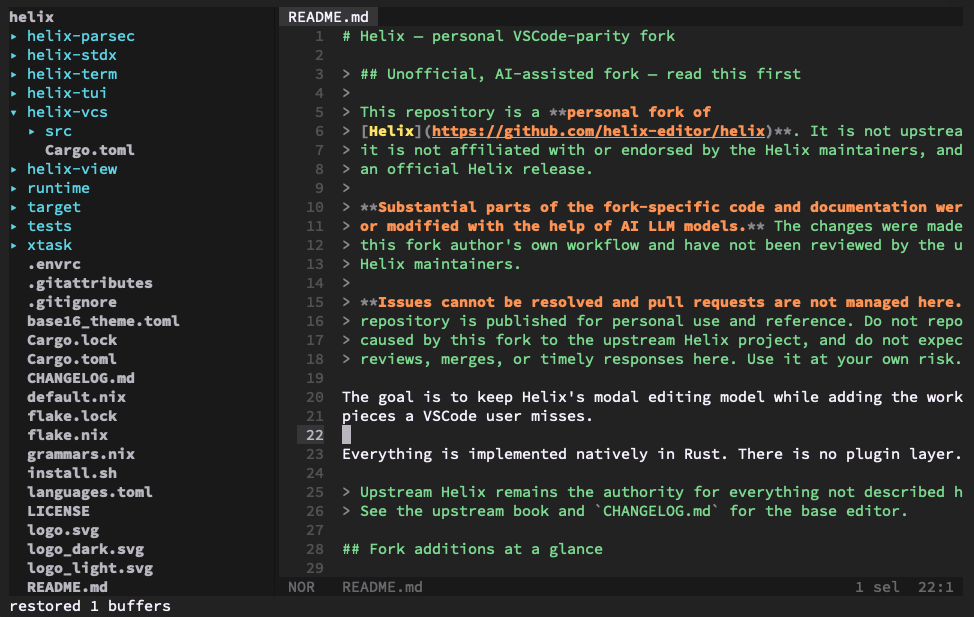

# Helix Code



A personal, AI-assisted fork of [Helix](https://github.com/helix-editor/helix)
that keeps modal editing while adding the VSCode-style workflow pieces this fork
author uses every day. Everything is implemented natively in Rust; there is no
plugin layer.

> **Unofficial fork — read this first.** This is **not** upstream Helix and is
> not affiliated with or endorsed by the Helix maintainers. Substantial parts of
> the fork-specific code and documentation were written or modified with AI
> assistance and have not been reviewed upstream. **Issues cannot be resolved
> and pull requests are not managed here.** This repository is published for
> personal use; do not report fork problems to upstream Helix, and do not expect
> support, reviews, merges, or timely responses. Use it at your own risk.

## How to Install

Both installers build from the `main` branch with native-CPU optimizations
(`-C target-cpu=native`), fat LTO, one codegen unit, and stripped binaries.
There are no release tags or prebuilt artifacts.

### Homebrew

```sh
brew tap yaa110/helix https://github.com/yaa110/helix
brew install yaa110/helix/helix
```

After new commits on `main`:

```sh
brew update
brew reinstall yaa110/helix/helix
```

### curl installer

```sh
curl -fsSL https://raw.githubusercontent.com/yaa110/helix/main/install.sh | sh
```

The script downloads `main` and compiles `hx` locally. It requires **Rust 1.90
or newer**, plus `git` and a C/C++ compiler for tree-sitter grammars.

It installs to `~/.local` by default:

- `~/.local/bin/hx` — wrapper that sets `HELIX_RUNTIME`
- `~/.local/libexec/helix/hx` — compiled binary
- `~/.local/share/helix/runtime` — themes, queries, grammars

If `~/.local/bin` is not already on `PATH`:

```sh
export PATH="$HOME/.local/bin:$PATH"
```

Useful options:

```sh
# Different prefix
HELIX_INSTALL_DIR="$HOME/.helix" \
  curl -fsSL https://raw.githubusercontent.com/yaa110/helix/main/install.sh | sh

# Skip the long grammar build; hx still works without syntax grammars
HELIX_SKIP_GRAMMARS=1 \
  curl -fsSL https://raw.githubusercontent.com/yaa110/helix/main/install.sh | sh
```

Verify the installed build:

```sh
hx --version
```

## New Features

### File tree and sidebar

`<space>b` shows and focuses the tree; press it again from the editor to hide
it. The tree is search-first: typing filters it live with fuzzy matching.

| Direct key | Action |
| --- | --- |
| printable characters | Live fuzzy filter |
| `Backspace` | Delete the last query character |
| `Ctrl-u` / `Ctrl-w` | Clear the query / delete the last query word |
| `Down` / `Up` | Move the selection |
| `Ctrl-Down` / `Ctrl-Up` | Smooth-scroll by `scroll-lines` (default 3) |
| `Right` / `Left` | Expand/open, or collapse/parent |
| `Enter` | Open the selected file and focus the editor |
| `Tab` | Open the selected file, or return to the editor on a directory |
| `Esc` | Clear the filter; when empty, return focus to the editor |

A dedicated `Find:` box sits below the project name and filters files with the
same fuzzy matcher as `<space>f`.

Press `<space>` in the tree to open a categorized which-key-style hint box:

| Space command | Action |
| --- | --- |
| `j` / `k` | Move down / up |
| `h` / `l` | Collapse / expand |
| `Enter`, `o` | Open |
| `s` / `v` | Open in a horizontal / vertical split |
| `a` / `A` | Create a file / directory |
| `r` | Rename |
| `d` | Delete (confirmation defaults to No) |
| `c` / `m` / `p` | Copy / cut / paste |
| `y` / `Y` | Copy the absolute / relative path |
| `x` | Close the current buffer |
| `X` | Close all other buffers and their splits |
| `W` | Open a recently used workspace |
| `/` | Open global search |
| `b` | Hide the sidebar |
| `w` | Show two-letter jump labels |
| `g` / `G` | First / last row |
| `J` / `K` | Move ten rows |
| `H` / `R` | Collapse all / refresh |
| `D` | Toggle dirty-files-only view |
| `.` | Reveal the current buffer |
| `[` / `]` | Shrink / grow the sidebar |
| `<` / `>` | Scroll long rows left / right |
| `q` / `Esc` | Return to the editor / close the command box |

Additional tree behavior:

- Indentation guides are enabled by default and use a muted gray, so deep
  trees stay readable without competing with names or selection.
- Git status colors: modified files use the `diff.delta` color, untracked files
  use `diff.plus`, conflicts use `diff.delta.conflict`, and directories inherit
  the color of changed children; gitignored files use a muted gray. `<space>D`
  shows dirty files only; status is refreshed in the background (every 2s in
  dirty-only mode, otherwise 10s).
- `.git`/VCS directories are never listed, expanded, or searched. Fuzzy tree
  search filters loaded/expanded rows and excludes gitignored entries.
- Long names are clipped at the pane boundary; the statusline shows the full
  selected path, and `<space><` / `<space>>` scroll long rows.
- Selection is shown with the row background only; tree names stay regular
  (not bold), and the sidebar border keeps its normal color when focused.
- Opening a file from any picker expands and selects it in the tree.
- `<space>x` closes the current buffer; `<space>X` force-closes every other
  buffer and its splits.
- `<space>W` reopens a recently used workspace from a global LRU list.
- Deleting an open file closes its buffer and reveals the next/previous buffer;
  deleting a closed file selects the adjacent file instead of jumping to the
  bottom of the tree.
- `<space>e` / `<space>E` open the file explorer at the workspace / current
  working directory.

### Global search

`<space>/` opens a floating search-and-replace window with a source preview.
It keeps the previous query, replacement, options, results, cursor, and
selection when reopened. `<space>/` from the tree opens it too, and `<space>b`
from search returns to the tree.

- `Find:` and `Replace:` inputs.
- Options: `[Aa]` case, `[ab]` whole word, `[.*]` regex, `[AB]` preserve case.
- `Alt-c` / `Alt-w` / `Alt-r` / `Alt-p` toggle those options directly.
- `<space>` opens a categorized options hint box; `c`/`w`/`r`/`p` toggle the
  same settings, `/` closes the window, `b` opens the tree.
- `Enter` previews/opens the selected match; `Esc` closes without moving the
  cursor.
- Empty search shows a hint; no matches shows `No results found`.
- Replace current/all with `Ctrl-r` / `Ctrl-Alt-Enter`.

### Peek and code lenses

- `gP` peeks the definition; `gR` peeks references.
- Both use a searchable floating preview picker with source preview.
- `Enter` jumps; `Esc` closes without moving the cursor.
- Reference peek excludes the declaration by default.

Code lenses use the same peek-style picker:

- `<space>l` — lenses on the cursor line.
- `<space>L` — all lenses in the file.
- `Enter` executes the selected LSP command; `Esc` cancels.
- The first lens on the cursor line also appears in the statusline.
- Lenses supplied through `codeLens/resolve` are resolved automatically.
- This fork enables `gopls.config.codelenses.test = true`, because recent gopls
  versions disable `run test` lenses by default.

### Editing and workflow

- **Session restore** of buffers, split layout, per-view selections and scroll,
  sidebar state, and search inputs per workspace. Sessions are stored in a
  compact binary format. Split layout and each view's selection/scroll are
  restored; hidden buffers are reopened after the visible views.
- **Automatic file reload** with silent reload for clean buffers and a
  Keep/Reload/Overwrite prompt for dirty buffers.
- **F1 action picker** (`F1` or `<space>t`): base64/hex encode/decode, case
  conversions, line sorting, minify/beautify, format document, and create
  file/folder from a relative path (parent folders are created automatically).
- **Always-visible Zellij-style buffer tabs** (`bufferline = "always"`):
  numbered compact tabs with file-type icons, muted separators, an
  accent-colored active tab (no bold/underline), and a modified dot. The active
  tab stays visible when the strip overflows.
- **Full-width powerline**: spans the tree and buffers. Left:
  `[mode][spinner][branch][file name][read-only][modified]`; right:
  `[diagnostics][selections][selection length] │ [position][total lines] │
  [encoding][line ending][indent style][file type]`.
- **Terminal title**: the window/tab title is set to `Hx | <buffer>`.
- **Layout**: `[panes][tabs]`, then `[panes][breadcrumbs]`, then
  `[panes][code]`, then a full-width command/error line, with the full-width
  powerline at the very bottom. Breadcrumbs show the current file path relative
  to the project.
- **Startup panes**: opening a file, stdin, or a git commit message starts with
  the tree and tabs hidden; opening a folder restores the last global pane
  layout. `<space>T` toggles the tab bar, and pane visibility is saved globally
  (not per workspace). Directory startup no longer opens the slow file picker,
  and git status is collected in a background worker.
- **Binary-file guard**: images and other binary files are detected before
  decoding and reported instead of rendering terminal garbage.
- **Monokai Community (Filter Spectrum)** as the default theme.

### Defaults

- Mouse capture and middle-click paste are disabled; enable with `mouse = true`
  / `middle-click-paste = true`.
- Cursor shape: underline in Normal/Select, I-beam-style bar in Insert.
- `cursorline`, `color-modes`, `auto-save`, and `true-color` are enabled.
- Auto-save runs on focus loss and after 1 second of inactivity.
- `scrolloff = 0`, `insert-final-newline = false`, and `popup-border = "all"`.
- File picker/tree show hidden files (`hidden = false`); symlink
  deduplication is off (`deduplicate-links = false`).
- Smart tab is disabled.
- The statusline defaults to:
  - left: mode, spinner, branch, file name, read-only, modified
  - right: diagnostics, selections, selection length, position, total lines,
    encoding, line ending, indentation style, file type
  - diagnostics severity: warning, error, hint
- Soft wrap is enabled; wrapped rows count as one logical line for `j`/`k`,
  arrow keys, selections, and counts such as `5x`. The wrap marker is shown in
  the gutter with the same muted color as whitespace markers, so code and
  underlines are not shifted.
- Indent guides are enabled with `▏`, skipping the first level.
- Spaces and tabs are visible by default using `·` and `→`; NBSP, narrow
  NBSP, and newline markers are off.
- Smooth scrolling: `Ctrl-Up` / `Ctrl-Down` moves by `scroll-lines` (default 3)
  in the editor and in the focused tree.
- Line numbers default to `both`, rendering `absolute │ relative` side by side.
  Set `[editor] line-number = "absolute"` or `"relative"` to change it.
